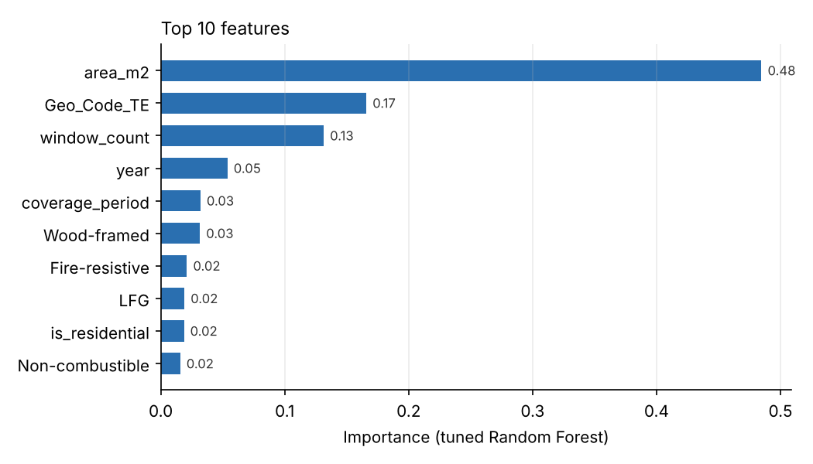
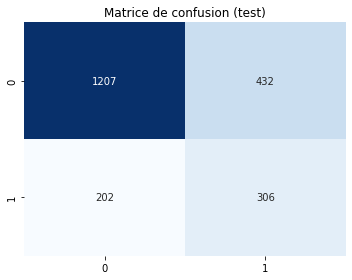
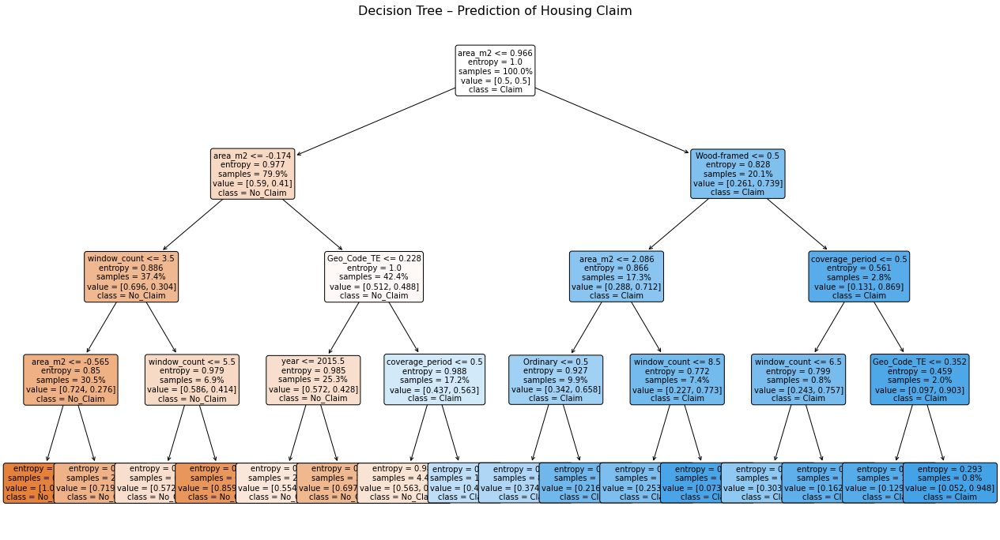
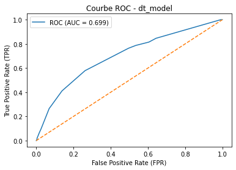
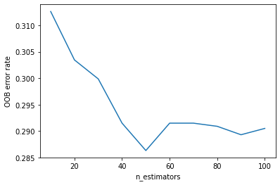
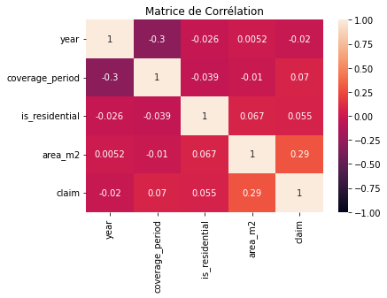
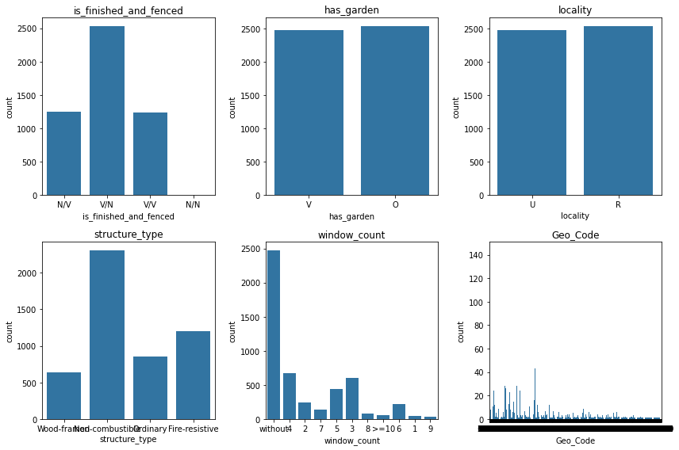

# 🏠 Home Insurance Claim Prediction

Data Mining project: predict whether a **home insurance policy will lead to a claim**, from the characteristics of the building
and of the contract. The full pipeline goes from data cleaning to a tuned **Random Forest**, with **association rules** used for feature engineering.


> Academic project — Data Mining course, IIT Sfax, 2025/2026. Use case: claim risk analysis for an insurance company.

---

## 🎯 Problem

An insurer that cannot anticipate claims ends up with **uniform premiums** (unfair pricing) and **poorly sized financial reserves**.
The goal is to predict the binary target `claim` (claim filed or not) for each policy.

| | Rows | Claim rate |
|---|---|---|
| Training set | 5,012 | 22.5 % |
| Test set | 2,147 | 23.7 % |

The classes are **imbalanced**: missing a claim (false negative) is the costly error, so the models are tuned on **recall** of the claim class.

**Features:** year, coverage period, residential use, building finished / fenced, garden, urban or rural locality, area (m²),
structure type, number of windows, geographic code.

## 🔧 Pipeline

| Step | What was done |
|---|---|
| **Cleaning** | Dropped the empty `risk_score` column, empty rows and the identifier `policy_id` |
| **Missing values** | `area_m2` → training median · `has_garden` → derived from `locality` (perfect association, **Cramér's V = 1.0**) · `Geo_Code` → non-numeric codes replaced, then **mode per (locality, structure type)** |
| **Encoding** | One-hot (`structure_type`), split of `is_finished_and_fenced` into two binary features, `OrdinalEncoder` for binary features |
| **Outliers & scaling** | IQR capping of `area_m2` (limits learned on train) + `RobustScaler` |
| **Target encoding** | Smoothed mean claim rate per geographic code, computed **out-of-fold** on train to avoid target leakage |
| **Association rules** | **Apriori** on binary features; the strongest rules (lift > 1, conviction > 1) led to a synthetic feature **`LFG`** = fenced ∧ garden ∧ urban |
| **Models** | Decision Tree (interpretable baseline) → Random Forest (OOB analysis) → **RandomizedSearchCV** (5-fold, scoring = recall) |
| **Evaluation** | 10-fold cross-validation on train, then a **single** evaluation on the held-out test set |

Leakage was checked at every step: imputation values, scaling limits and encodings are always learned on the training set only.

## 📊 Results (test set)

| Model | Accuracy | Claim recall | Claim precision | Claim F1 | ROC AUC |
|---|---|---|---|---|---|
| Decision Tree (`max_depth=4`, balanced) | 0.70 | 0.58 | 0.41 | 0.48 | 0.70 |
| Random Forest (300 trees, balanced) | 0.71 | 0.55 | 0.42 | 0.47 | — |
| **Tuned Random Forest (top 10 features)** | **0.70** | **0.60** | **0.41** | **0.49** | **0.72** |

The tuned Random Forest detects **6 claims out of 10** (306 of 508), against a claim rate of 24 % in the data.
Train and test scores are close (CV F1 on train: 0.45 · test: 0.49): the model does not overfit.

| Feature importance | Confusion matrix — tuned model (test) |
|---|---|
|  |  |

The building **area**, the **location** (geographic risk) and the **number of windows** are the main risk drivers.

<details>
<summary>More figures</summary>

**Decision tree**



| ROC curve — Decision Tree | OOB error vs number of trees |
|---|---|
|  |  |

| Correlation matrix | Categorical distributions |
|---|---|
|  |  |

</details>

## 🚀 Next steps

- Handle class imbalance with **SMOTE** or threshold tuning on the predicted probabilities
- Try **gradient boosting** (XGBoost, LightGBM), usually stronger on tabular data
- Enrich the data with external sources (local weather, socio-economic indicators)

## ▶️ Run the notebook

```bash
pip install -r requirements.txt
jupyter notebook insurance_claim_prediction.ipynb
```

The dataset is included in [`data/insurance.xlsx`](data/insurance.xlsx) (sheets `train` and `test`).

## 👩‍💻 Authors

Academic team project — supervised by M. Tarek Ben Saïd.

- **Chaima Maatar** — [GitHub](https://github.com/MaatarChaima)
- **Mariem Lanouar**
- **Salha Hentati**
- **Ons Rekik**
